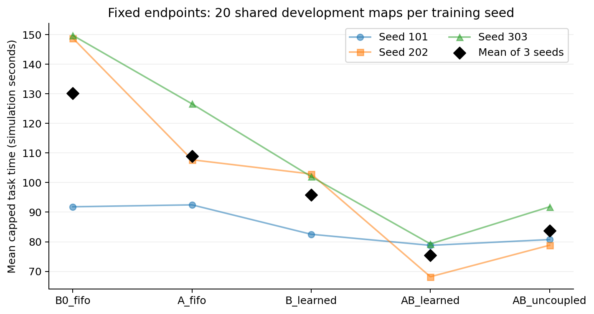
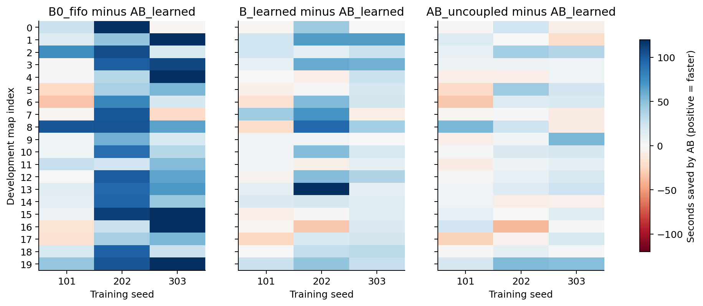
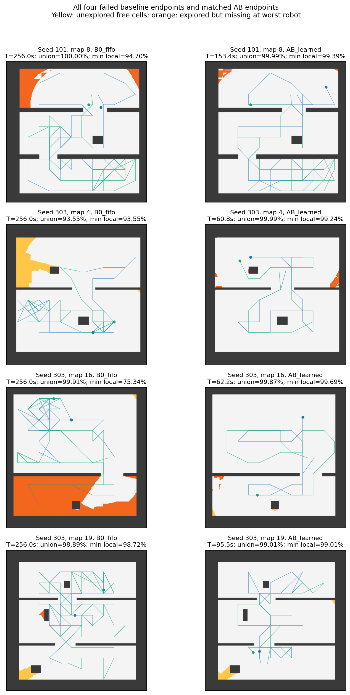
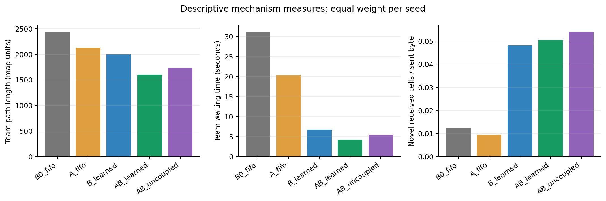
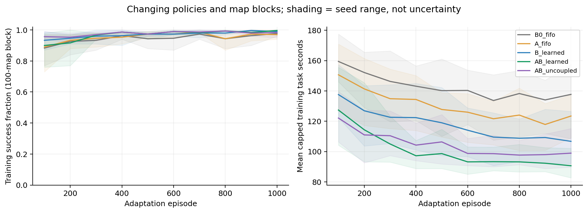

# 完整独立三种子实验：结果复核与结论

本轮于北京时间2026年10月15日14:15完成。本报告从保留的原始记录重新计算固定终点成绩，核对模型、预算和审计，未新增训练或策略评估。

## 结论先行

在当前两机器人、simple_rooms_v1、通信范围65地图单位、每发送端2048字节/秒的固定开发集条件下，完整AB在三个独立训练种子上均取得五组最低的平均任务时间，且全部成功。跨种子平均任务时间75.410秒，相对B0的130.133秒缩短42.05%，相对去耦合AB的83.795秒缩短10.01%。这支持完整方法在本协议下的效率优势，以及耦合机制的平均增益。

需要收紧两点表述：A单独使用不是每个种子都获益；耦合增益也不是每张图、每个种子同样稳定。2×2交互效应符号不一致，不能据此声称稳定的超加性协同。此次仍是反复使用的20张开发图，尚无独立测试、带宽扫描、其他地图族或多于两机器人的证据。

## 协议与方法含义

- 三个训练种子101、202、303独立初始化、预训练和训练消息头；同一种子内五组共享本种子的共同起点。每种子移动预训练100图/9000次SAC，消息头在100训练图采样后监督5000步；五组各1000训练图/新增20000次SAC，固定终点累计29000次。消息头和上下文编码器在适应阶段冻结。旧轮A/FIFO起点与本轮中性B0/FIFO起点不同，不混合排名。
- B0_fifo也是学习的移动策略，保留基础通信、地图差异会合特征和相同训练目标，不是无通信或随机策略。A_fifo用预计可交付收益及距离成本构造会合价值；B_learned使用学习选包；AB_learned组合两者，并把学习选包的预计收益反馈给会合价值。
- AB_uncoupled执行端仍使用学习选包，但会合收益按FIFO估计，因此对比考察收益估计和实际内容选择的一致性，不是关闭消息传输。A包含收益特征和距离成本的整体变化，不是单独对某一个标量做因果隔离。
- 每个固定终点在完全相同的20张开发图上贪心执行一次。成功要求两个机器人的本地自由格覆盖率均达到99%；失败统一记256秒。时间为仿真任务时间，距离为地图单位；地图没有米制标定。
- 总保留预算15600条训练侧轨迹、327000次SAC、15000次消息头监督更新、300条开发评估；留出测试策略执行0。预检和工程探针另列，不计入此预算。

## 固定终点成绩

| 方法 | seed101秒 | seed202秒 | seed303秒 | 三种子均值 ± 样本标准差（秒） | 合计成功 |
| --- | ---: | ---: | ---: | ---: | ---: |
| B0_fifo | 91.820 | 148.820 | 149.757 | 130.133 ± 33.183 | 56/60 |
| A_fifo | 92.472 | 107.708 | 126.603 | 108.928 ± 17.098 | 60/60 |
| B_learned | 82.525 | 102.895 | 102.009 | 95.810 ± 11.513 | 60/60 |
| AB_learned | 78.782 | 68.175 | 79.273 | 75.410 ± 6.271 | 60/60 |
| AB_uncoupled | 80.743 | 78.827 | 91.814 | 83.795 ± 7.010 | 60/60 |

这里的±表示三个“各自在20图上的均值”的样本标准差，不是标准误或置信区间。60条种子×地图记录只包含三个独立训练种子、20张共用地图，不能当作60个独立训练重复。

AB相对B0在三个种子上分别节省14.20%、54.19%、47.07%。AB的种子均值标准差6.271秒小于其他四组，但重复数只有3，只能描述本次观察到的离散程度，不能保证未来初始化同样稳定。

## 模块贡献与逐图配对

下表均以“前者任务时间−后者任务时间”计节省，正数为后者更快。节省比例定义为“三种子等权总体均值差 / 前者总体均值”，不是每个种子百分比的算术平均；两种口径同时保存在机器可读结果。快/慢/平是60条配对结果的描述计数，不作为独立样本显著性检验。B0→AB是为展示整体效果补充的描述性对比，其余五项及交互为开跑前固定对比。

| 对比 | 平均节省秒 | 总体均值缩短比例 | 60条配对节省中位数秒 | 后者快/慢/平 |
| --- | ---: | ---: | ---: | ---: |
| B0_fifo → A_fifo | 21.205 | 16.29% | 13.191 | 44/16/0 |
| B0_fifo → B_learned | 34.323 | 26.38% | 26.384 | 45/15/0 |
| B_learned → AB_learned | 20.399 | 21.29% | 17.630 | 43/17/0 |
| A_fifo → AB_learned | 33.518 | 30.77% | 27.551 | 49/11/0 |
| AB_uncoupled → AB_learned | 8.385 | 10.01% | 5.927 | 40/20/0 |
| B0_fifo → AB_learned | 54.722 | 42.05% | 45.623 | 52/8/0 |

每个种子的配对结果按“平均节省秒 / 中位节省秒 / 更快:更慢图数”列出：

| 对比 | seed101 | seed202 | seed303 |
| --- | ---: | ---: | ---: |
| B0_fifo → A_fifo | -0.652 / 1.034 / 11:9 | 41.112 / 44.396 / 18:2 | 23.154 / 11.608 / 15:5 |
| B0_fifo → B_learned | 9.295 / 2.509 / 12:8 | 45.926 / 41.507 / 18:2 | 47.748 / 32.648 / 15:5 |
| B_learned → AB_learned | 3.743 / 1.766 / 11:9 | 34.720 / 36.714 / 15:5 | 22.735 / 21.194 / 17:3 |
| A_fifo → AB_learned | 13.690 / 5.674 / 14:6 | 39.533 / 33.061 / 18:2 | 47.329 / 35.148 / 17:3 |
| AB_uncoupled → AB_learned | 1.961 / 1.979 / 11:9 | 10.652 / 8.339 / 14:6 | 12.540 / 12.364 / 15:5 |

B单独使用在三个种子均降低平均任务时间，相对B0总体缩短26.38%。在B的基础上加入A及耦合，AB进一步缩短21.29%；在A的基础上使用学习选包及相应耦合，AB进一步缩短30.77%。这两项比较都包含完整方法相应机制的变化，不能分别解释为与上下文无关的固定独立效应。

A单独相对B0总体缩短16.29%，但seed101反而慢0.652秒，双方均成功的19图慢2.317秒；seed202、303分别节省41.112、23.154秒。因此旧轮“A独立收益偏弱”的判断需要更新为“A收益依赖训练种子/共同起点，在本轮两个种子上明显有效，一个种子未改善平均耗时”。不能把A写成无效，也不能写成每次都有效。

## 耦合增益、异常值与交互

耦合相对去耦合的平均节省分别为1.961、10.652、12.540秒，对应2.43%、13.51%、13.66%。三个种子均值方向一致，总体节省8.385秒；逐图为11/20、14/20、15/20更快，合计40/60更快、20/60更慢。对每张图先跨三个种子平均，仍只有14/20图更快。

seed101耦合优势较弱：删掉最大收益图map8后，平均节省从1.961变成−0.818秒；该种子的平均优势依赖这张图。seed202、303各自删掉最大收益图后，仍节省8.446、10.325秒。按先跨种子平均的20张地图做同样敏感性分析，去掉最大收益图后总体节省6.655秒；逐次留出一个训练种子，剩余两个种子的平均节省范围6.307～11.596秒。这些都是事后描述性稳健性检查，不是置信区间。

耦合的最差退步案例之一是seed202/map16，完整AB相对去耦合慢38.781秒；seed101/map6慢32.744秒。完整逐图差异、所有退步地图和最大收益/损失图见[配对CSV](paired_differences.csv)与[supplemental_analysis.json](supplemental_analysis.json)。这些案例保留在结果中，没有剔除后重新报主成绩。

2×2交互定义为 `T_A + T_B − T_B0 − T_AB`，正值代表时间节省超出两个单独收益相加。三个种子为+4.395、−6.393、−0.419秒，均值−0.805秒、种子样本标准差5.404秒。符号不一致，因此本轮不支持稳定的超加性协同。完整AB平均优于去耦合AB与“正交互”是不同命题，前者有当前结果支持，后者没有。

## 成功率和失败类型

B0在三个种子为19/20、20/20、17/20，合计56/60；其余四组均为60/60。仅出现四条失败，不能以此宣称所有通信条件下都可靠。四条B0失败都达到256秒时限：

| seed / 开发图 | 联合覆盖 | 最差本地覆盖 | 未探索自由格 | 已探索但最差机器人缺失格 | 直接未达标项 |
| --- | ---: | ---: | ---: | ---: | --- |
| 101 / 8 | 100.000% | 94.700% | 0 | 2455 | 本地地图同步未达标 |
| 303 / 4 | 93.552% | 93.552% | 2951 | 0 | 联合探索未达标 |
| 303 / 16 | 99.915% | 75.336% | 41 | 11846 | 本地地图同步未达标 |
| 303 / 19 | 98.890% | 98.718% | 484 | 75 | 联合探索未达标 |

两条联合探索不足、两条本地地图同步不足；这是终点状态分类，不证明失败的算法因果。seed303/map19同时存在75格已探索但本地缺失，因联合覆盖本身未达标归入探索不足。其余方法在相同图成功，不意味着已经隔离出某个动作造成基线失败。

为了判断收益是否只是失败罚时造成，另看双方均成功图：完整AB相对B0在三个种子仍分别平均节省8.325、80.645、50.599秒。因而本轮总体效率优势并非仅来自把四条失败变成功；这一辅助口径也有条件选择限制，主结果仍保留全部失败。

图中黄色表示未探索自由格，橙色表示联合已探索但最差本地机器人尚未获得的格，白色为该机器人已知自由格；两条线为实际保留轨迹。展示的是全部四条基线失败，没有只挑其中一例。

## 机制指标：支持解释，但不证明因果

| 方法 | 团队总路程 | 两机等待秒之和 | 联合达到99%时间秒 | 任务−联合达标时间秒 | 新增接收格/发送字节 |
| --- | ---: | ---: | ---: | ---: | ---: |
| B0_fifo | 2445.8 | 31.248 | 88.629 | 41.503 | 0.01250 |
| A_fifo | 2127.2 | 20.319 | 75.584 | 33.344 | 0.00935 |
| B_learned | 1997.5 | 6.667 | 76.113 | 19.697 | 0.04822 |
| AB_learned | 1600.6 | 4.209 | 62.235 | 13.176 | 0.05053 |
| AB_uncoupled | 1740.1 | 5.442 | 63.464 | 20.330 | 0.05416 |

各项先在种子内20图取均值，再在种子间等权平均。联合未达标时该项时间封顶256秒，“任务−联合时间”仅为时间差代理，不是精确的通信瓶颈因果分解。“新增格/发送字节”在种子内先求总量之比，再在三个种子间平均；不等于单图比率均值或传输协议净载荷效率。

完整AB相对去耦合，团队路程1740.1→1600.6，等待5.442→4.209秒，任务与联合达标时间差20.330→13.176秒。这与减少路径和后续同步拖延的解释一致。但seed101的AB路程反而略长（1692.8→1703.6），seed303的AB联合覆盖达标更晚（58.899→67.675秒），说明平均收益不能归结为所有阶段都更快。

学习内容选择相对FIFO总体提高新增信息/字节，但完整AB该比率0.05053低于去耦合0.05416，不能宣称完整AB在字节效率上也最好。seed303完整AB发送字节也多于去耦合，任务更快和总通信更少不是同一结论。

## 训练过程与机器适配

每组严格1000图、20000次新增SAC，未因开发成绩延长训练或挑选checkpoint。最后100张训练图中，AB成功率在三个种子为99%、100%、100%；但训练地图和策略随时间变化，不是固定模型的验证曲线，不能据此证明收敛或把它与开发贪心成绩直接比较。

图为每100回合分块、跨种子均值，阴影仅为三个种子的最小至最大范围。各组完整训练进程峰值RSS最高约3.04GiB，未再因内存不足中断。训练中曾发生一次几何审计误判导致停机，修复审计并补审后恢复，不能写成本轮从未中断。

## 验收与证据边界

- 逐条检查15000条适应训练记录和300000条新增SAC更新日志；重新加载15组初始/最终模型，核对同种子初始状态完全一致、最终Adam步数29000、头/上下文及头优化器冻结；所有300条开发记录与原自动汇总一致。
- 新增只读复核重新执行全部300条开发轨迹的几何、覆盖、速度、时限、通信事件与容量审计，并对600条共同预训练/监督采样轨迹统一重审；其他15000条适应训练轨迹沿用已完成的全量流水线审计并检查结果。
- 合计保留15900条轨迹、1349336段移动，进入障碍格内部0，边界/角点接触1008；通信流水线已核对66136671条事件。几何模型为连续点对像素内部，不能外推成有限半径实体机器人有碰撞裕量。
- 活动源码54文件与完成后身份和隔离快照一致；最初快照另行保留。seed101的共同阶段旧审计没有边界接触字段，本次从原始记录统一重算，没有把缺字段当作零。
- 10月14日审计修复与恢复有单独版本和补丁；B0保留模型、原始记录哈希不变，补审新增训练更新/策略评估均0。详见[恢复记录](PHYSICAL_AUDIT_RECOVERY_20261014.md)。
- 当前只增加结果分析，训练源码、模型与原自动报告均保留；新增策略执行0、测试执行0。复现入口、输入哈希和通过日志见[复核记录](final_readonly_review.json)、[复现说明](analysis_reproduction.json)。

## 论文可以写到哪里

可写：在固定简单室内图和单一受限通信配置下，三个完整独立训练种子的结果支持完整方法降低开发集任务完成时间；学习内容选择具有跨种子一致的平均收益；使会合收益估计与内容选择一致，相对去耦合配置有平均时间优势，但存在地图和种子依赖。

暂不能写：已证明普遍泛化、统计显著优于所有方法、稳定超加性协同、所有带宽/地图/机器人数量均有效、字节利用率全场景最佳，或学习选包多种子优于规则选包。本轮没有规则组，旧轮规则结果只能保留为旧协议的补充证据。

接下来建议先用冻结的15个终点做预先固定的带宽条件扫描，区分当前配置优势与跨带宽鲁棒性；详细执行范围、判据和预算已整理在[NEXT_STEPS.md](NEXT_STEPS.md)。该工作尚未启动，留出测试继续保留。
